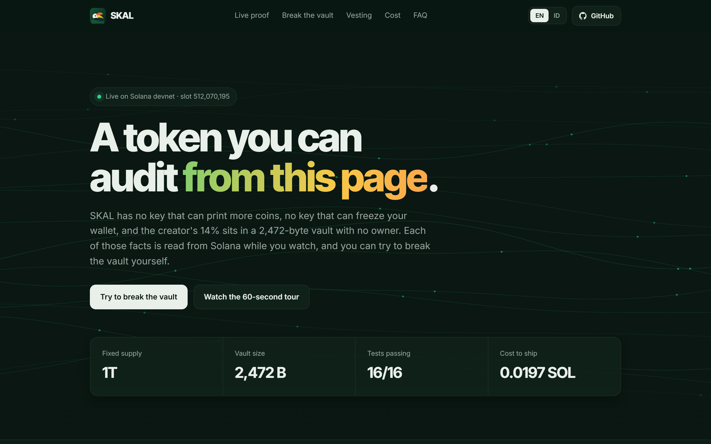
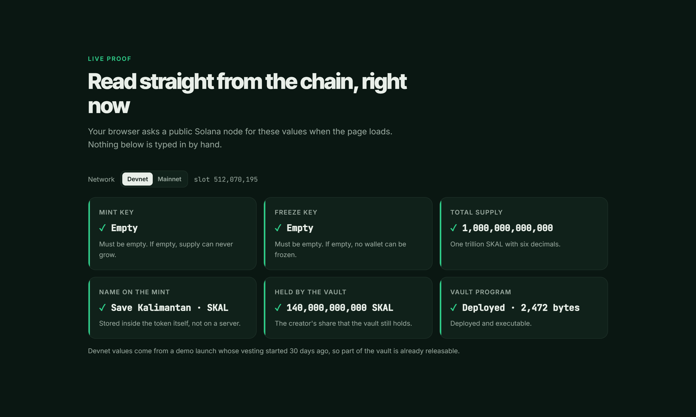
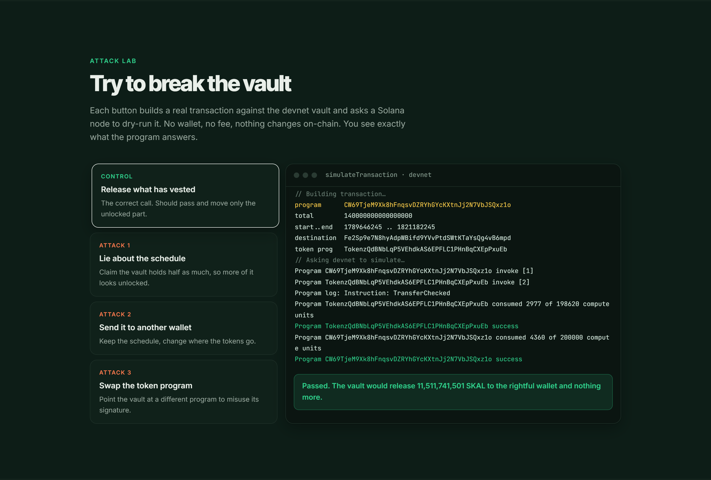
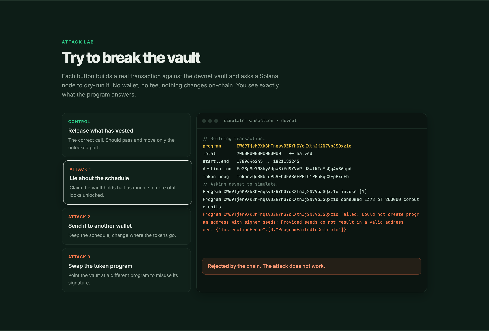
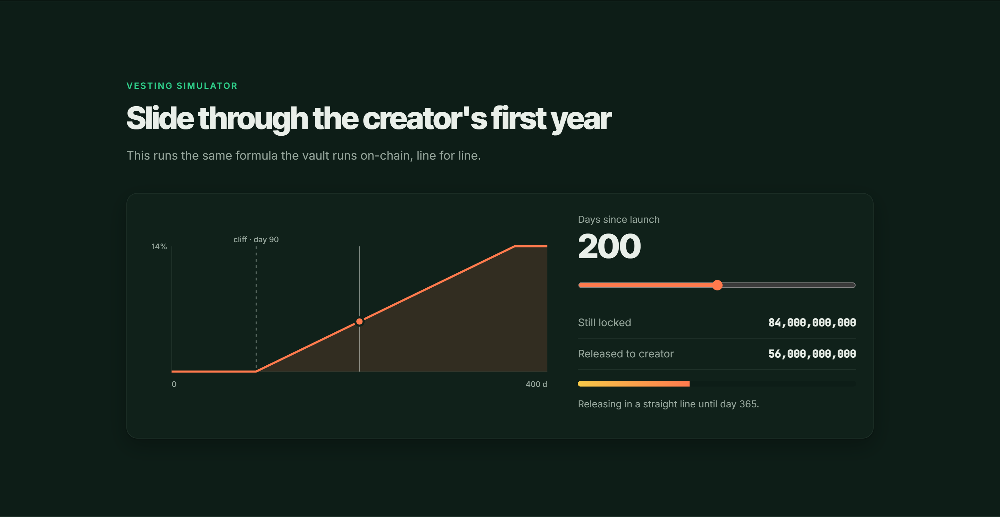

<div align="center">

# SKAL — Save Kalimantan

**A Token-2022 asset on Solana whose creator allocation is locked by a stateless Pinocchio vault.**

[Blueprint](docs/BLUEPRINT.md) · [Deployments](docs/DEPLOYMENTS.md) · [Security](SECURITY.md) · [Website](site/index.html)

   

</div>

---

> **Educational project.** The name *Save Kalimantan* is used for teaching purposes. This project raises no funds, promises no returns, and is not affiliated with any organization.

## Overview

SKAL is a fixed-supply token built on the Token-2022 standard. The three questions a holder should ask about any new token are answered on-chain:

| Question | Answer | How to verify |
|---|---|---|
| Can the creator mint more? | No | Mint authority is `null` |
| Can the creator freeze wallets? | No | Freeze authority is `null` |
| Can the creator dump their allocation? | Not for 12 months | 14% sits in a vault whose release rule is code |

**Website:** https://bryankwandou.github.io/skal/ · **Walkthrough video:** [site/media/walkthrough.mp4](site/media/walkthrough.mp4)



## Proof

Every value below is read live from Solana by the website, not typed in.

| Live on-chain checks | Attack lab: honest release passes |
|---|---|
|  |  |
| **Attack lab: fake schedule rejected** | **Vesting simulator** |
|  |  |

The attack lab builds real transactions against the devnet vault and dry-runs them with `simulateTransaction`:

| Scenario | Devnet result |
|---|---|
| Honest release | Passes, 4,360 compute units, moves only the vested part |
| Fake schedule (halved total) | `ProgramFailedToComplete`: seeds do not derive a valid address |
| Redirect to another wallet | `PrivilegeEscalation`: PDA signer not authorized |
| Swap token program | `custom program error: 0x1` |

## Key facts

| | |
|---|---|
| Name / symbol | Save Kalimantan / SKAL |
| Standard | SPL Token-2022 with on-mint metadata |
| Total supply | 1,000,000,000,000 SKAL (fixed) |
| Decimals | 6 |
| Creator allocation | 14%, vested: 90-day cliff, linear to day 365 |
| Vault program size | 2,472 bytes (SBPF v3) |
| On-chain cost to ship | 0.0197 SOL total, split into 0.0054 (mint) + 0.0143 (vault) |
| Devnet | Live, 16/16 end-to-end tests passing ([addresses](docs/DEPLOYMENTS.md)) |

## Repository layout

```
vault/          SKAL vesting vault (Pinocchio, no_std, 143 lines)
src/            Ringan: minimal custom token program, research baseline
client/         Node.js clients, launch script, test suites
scripts/        SBPF build and ELF section-header stripper
docs/           Blueprint, deployments, runbook, Indonesian notes
site/           Static website, deployable to Vercel as-is
```

## Quick start

Requirements: Rust, Solana CLI ≥ 2.x with `cargo build-sbf`, Node.js ≥ 20, Python 3.

```bash
cd vault && cargo build-sbf --arch v3 && cd ..
```

```bash
python scripts/strip_elf.py vault/target/deploy/skal_vault.so vault/target/deploy/skal_vault.min.so
```

```bash
cd client && npm ci
```

Run the test suite against a fresh local validator:

```bash
solana-test-validator --reset
```

```bash
solana -ul program deploy vault/target/deploy/skal_vault.min.so
```

```bash
node client/test-skal.mjs <vault-program-id> ~/.config/solana/id.json
```

Expected: `16 passed, 0 failed` (output is in Indonesian: `16 lulus, 0 gagal`).

## Mainnet

Under a 0.01 SOL budget the launch is phased: the mint goes live first and the creator allocation sits in the vault's token account, where nothing can move it until the vault program (whose SHA-256 is published in advance) is deployed. See [docs/BLUEPRINT.md](docs/BLUEPRINT.md#launch-plan-under-a-001-sol-budget). Mainnet deployment follows the runbook in [docs/DEPLOY.md](docs/DEPLOY.md). Official addresses are published only in [docs/DEPLOYMENTS.md](docs/DEPLOYMENTS.md). Any address not listed there is not SKAL.

## Documentation

- [Blueprint](docs/BLUEPRINT.md): design, token distribution, security model, costs
- [Deploy runbook](docs/DEPLOY.md): step-by-step mainnet launch
- [Ringan](docs/RINGAN.md): the 1,352-byte research token program
- [Catatan (Bahasa Indonesia)](docs/id/SKAL.md) and [naskah pitch](docs/id/PITCH.md)

## License

[MIT](LICENSE). No audit has been performed. See [SECURITY.md](SECURITY.md).
